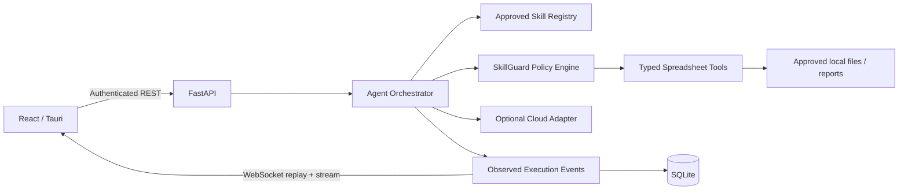

# AgentScope backend interface (v0.1)

Desktop depends on HTTP/WebSocket contracts, not Python imports. Runtime types are in `src/types.ts`; network behavior is in `src/api.ts`.

- REST base: `http://127.0.0.1:<port>/api`. Every call needs `Authorization: Bearer <session>`. Development defaults to port 8765; native Rust chooses a free loopback port and returns the token/base through the private `backend_connection` command.
- `GET /health`, `/conversations`, `/conversations/{id}/messages`, `/conversations/{id}/attachments`, `/tasks`, `/tasks/{id}/events`, `/skills`, `/settings`, `/audit`.
- `POST /conversations/{id}/messages` with `{content, attachment_ids, mode, skill_id}` returns `{run,message}`. A turn can select up to five workbook IDs. Omit `attachment_ids` to reuse the saved selection. Send `[]` for a turn without workbooks. The attachments endpoint also recovers references from legacy messages.
- Multipart `POST /files?conversation_id={id}` (`file`) registers a workbook in the conversation at upload time. Authenticated `GET /files/{id}/download` returns the actual file. Verified local workbooks are listed individually in `run.reports` with their source IDs. The legacy `run.result` remains available to existing clients.
- Multipart `POST /skills/import` (`files`) returns the installed Skill, registry status and scan findings. `POST /skills/{id}/enable` or `/disable` and `DELETE /skills/{id}` manage registry state.
- `POST /tasks/{id}/control` with `{action: pause|resume|cancel}`. `POST /approvals/{id}` with `{allowed:boolean}` resolves a specific permission request.
- `POST /settings` saves provider/model/mode and optionally an API key to OS keyring. `POST /settings/test` explicitly sends a test request. `POST /security/demo` emits synthetic policy decisions only.
- `POST /ws-ticket` returns a single-use, 30-second ticket. Connect to `ws://127.0.0.1:<port>/ws/runs/{id}?ticket=...`. History replays before live events; deduplicate by event ID. Reconnect with a new ticket. Heartbeats are protocol records, not execution evidence.
- Event fields: `id`, `run_id`, `step_id`, `timestamp`, `source`, `event_type`, `tool_name`, `status`, `permission_decision`, sanitized `arguments`, `result`, `duration_ms`, `error`, `message`, `mode`.
- The conversation groups runtime events by step, ACP events by observed tool-call ID, and MCP journal events by recorded sequence. ACP file diffs use the tool content carried by successful or failed updates. Provider filtering is recorded under a provider event. Local report receipts include the XLSX read-back check. [ACP v1 tool-call fields](https://agentclientprotocol.com/protocol/v1/tool-calls)
- `mode=demo` is synthetic evidence; `mode=real` records actual operations. A requested tool is not a successful execution. No private model reasoning is exposed.
- Authenticated `POST /shutdown` is used by the native lifecycle manager. Session secrets and provider keys must never appear in logs or source control.

## Isolated research evidence

`GET /api/research/readiness` exposes `appcontainer.mode`, `required` and the recorded isolation check result independently of provider sign-in. New `model.session_started` and `research.mcp_process_attested` events include the observed PID, AppContainer SID and integrity SID when those fields are available. The event projection keeps the general secret redaction rules in place.

`GET /api/isolated-lab/format-sessions` returns archived real-session identifiers, operator consent, MCP resource call IDs, delivered ACP permissions, verified canary PIDs, Excel validation and raw answers. The comparison is read-only and uses the existing loopback authentication. The separate Phase 7 audit endpoint retains its original observations.

`src/components/IsolatedInjectionLab.tsx` owns session selection, polling and explicit suite launch. The `isolated/` components render individual trials, decision evidence and archived format sessions. The contracts live in `src/types/isolatedLab.ts` and are re-exported through `src/types.ts`. The authenticated client remains in `src/api.ts`. The Rust sidecar supervisor continues to manage process lifetime.

## Component relationship

Skill instructions guide the orchestrator but cannot grant tools or bypass SkillGuard. Desktop consumes the versioned interface; it has no Python implementation dependency. Production consumes one compiled executable artifact.
